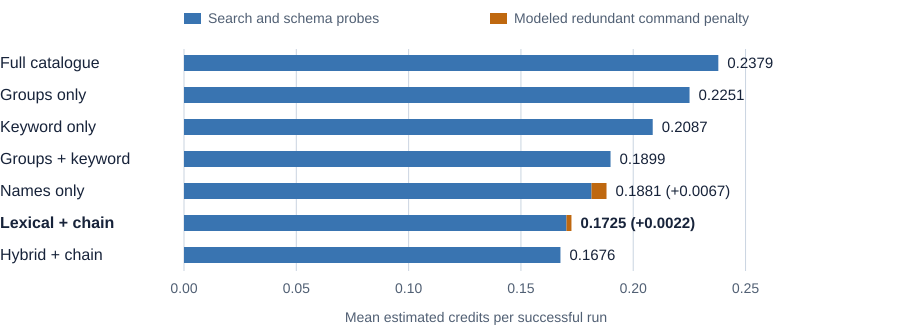

# Command discovery

`archicad_list_commands` uses lexical search over command names and descriptions. Batch phrases for separate workflow steps in `keywords`, and use `groups` to narrow the search. This search finds commands for locating and publishing a Publisher Set.

```json
{"groups":["navigator"],"keywords":["find configured publisher sets","publish a publisher set"]}
```

- Group IDs are listed in the tool description. Omit `keywords` to browse command names.
- Ranked search takes one hit from each phrase in turn and returns up to 12 unique commands with descriptions in `matches`.
- Exact command names report their status in `exact_matches`, with `keyword_index` pointing to the input phrase. An exact hit returns the name. If the name already appeared in the chain, the reply confirms the status. A ranked search can still return the description for a command seen by name alone.
- Pass the latest `query_id` on every follow-up for the same user request, including when you replace the keywords or change groups. The page's `remaining` counts ranked candidates whose descriptions are still available for the current search.
- The 12-character ID refers to an in-memory search snapshot. It can expire after 30 minutes of inactivity, be evicted under load, or become unavailable after a restart. Omit it to start a fresh search.
- Use `archicad_get_command_schema` to verify arguments and behavior before running a selected command.

Ranked search also uses aliases generated from Open English WordNet. Literal name matches have more weight than synonym matches. The tool generator refreshes the bundled lookup from the current command names and a pinned WordNet snapshot, cached locally after its first download. The server reads the bundled file during search. [Open English WordNet](https://en-word.net/downloads)

## Final result-policy benchmark

Two result formats were tested on 50 new non-obvious prompts with one GPT-6 Luna High run per prompt and format. The suite covered 20 terminology cases, 20 multi-command workflows, and 10 requests for unavailable capabilities. Both formats used the same 801-command catalogue, lexical ranker, WordNet aliases, exact-name handling, and continuation logic. The comparison includes each format's page limit. Two answer-key corrections were applied to both formats.

| Measure | Three per phrase | Round robin, 12 pooled |
| --- | ---: | ---: |
| Correct after audit | 47/50 | **49/50** |
| Multi-command workflows correct | 20/20 | 20/20 |
| Mean observed-use credits per shared success | 0.0451 | **0.0382** |
| Mean credits at the same cache split | 0.0444 | **0.0389** |
| Mean discovery calls per shared success | 1.79 | **1.45** |
| Median elapsed time per shared success | 15.28 s | **14.76 s** |
| Follow-up searches using a continuation ID | 39/40 | 28/28 |

Production uses round robin. The two additional correct answers came from terminology cases, and that margin leaves the accuracy difference uncertain. Across the 47 prompts both formats got right, round robin returned larger catalogue responses and used fewer discovery calls. Estimated credits fell by **12%** when pricing both formats at the same cache shares of 87.9% on initial input and 90.2% on follow-up input. Removing the pair where the per-phrase agent printed the full Codex tool registry reduced the credit saving to **8%**. [Codex Luna credit rates](https://learn.chatgpt.com/docs/pricing#token-rates)

Mean elapsed time was 17.67 s for round robin and 16.59 s for per-phrase search. The round-robin mean includes a 132-second outlier.

## Earlier catalogue benchmark

Lexical + chain and Hybrid + chain each answered **19 of 20** prompts correctly after auditing the benchmark. Hybrid had a **3–4%** estimated credit advantage across the three scenarios. Lexical avoids the embedding model and vector index, and used about **74% fewer estimated credits** than the full catalogue in fresh sessions. The test ran each prompt once per variant across two rounds with slightly different agent instructions.

The bars show mean estimated credits per successful run. The search portion includes every schema probe and retry. The penalty models one additional model request per redundant command listed in the final workflow. The moderate and heavy projections add 32,000 and 128,000 warm cached tokens, respectively, to every model request. The benchmark used a longer continuation token and one combined result list.

### Empty context


### Moderate prior context


### Heavy prior context



The full report, runner, prompts, and per-trial measurements are preserved in commit `84503cd`. Read the report with `git show 84503cd:tests/benchmarks/command_discovery/RESULTS.md`.
