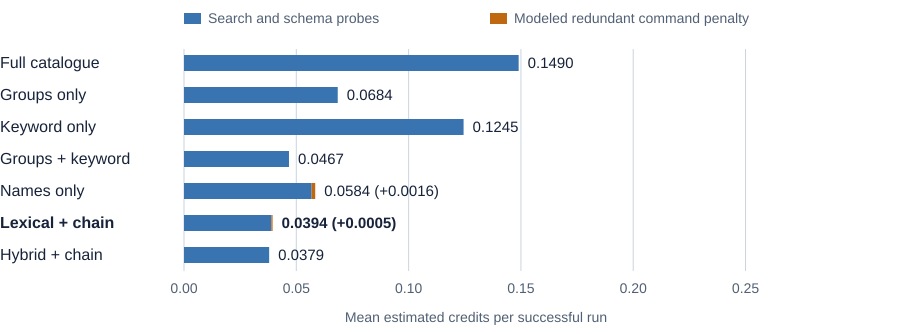
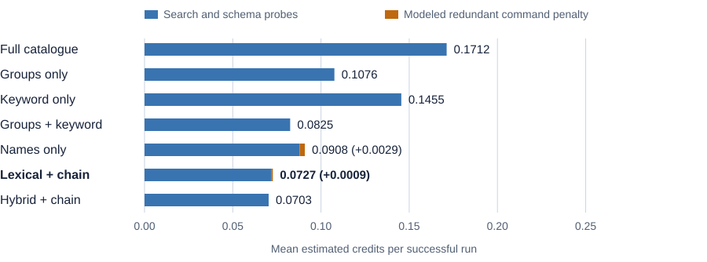

# Command discovery

`archicad_list_commands` uses lexical search over command names and descriptions. Batch phrases for separate workflow steps in `keywords`, and use `groups` to narrow the search. This search finds commands for locating and publishing a Publisher Set.

```json
{"groups":["navigator"],"keywords":["find configured publisher sets","publish a publisher set"]}
```

- Group IDs are listed in the tool description. Omit `keywords` to browse command names.
- Each keyword phrase returns up to three ranked command names. `keyword_index` points to the original input phrase. Ranked hits share a `descriptions` map keyed by name, so overlapping lists carry each description once.
- An exact command name within the selected groups returns its name and `found` status. If the name already appeared in the chain, the reply confirms the status. A ranked search can still return the description for a command seen by name alone.
- Pass the latest `query_id` on every follow-up for the same user request, including when you replace the keywords or change groups. Each phrase's `remaining` counts ranked candidates whose descriptions are still available after that page.
- The 12-character ID refers to an in-memory search snapshot. It can expire after 30 minutes of inactivity, be evicted under load, or become unavailable after a restart. Omit it to start a fresh search.
- Use `archicad_get_command_schema` to verify arguments and behavior before running a selected command.

Ranked search also uses aliases generated from Open English WordNet. Literal name matches have more weight than synonym matches. The tool generator refreshes the bundled lookup from the current command names and a pinned WordNet snapshot, cached locally after its first download. The server reads the bundled file during search. [Open English WordNet](https://en-word.net/downloads)

## Why lexical search

Lexical + chain and Hybrid + chain each answered **19 of 20** prompts correctly after auditing the benchmark. Hybrid had a **3–4%** estimated credit advantage across the three scenarios. Lexical avoids the embedding model and vector index, and used about **74% fewer estimated credits** than the full catalogue in fresh sessions. The test ran each prompt once per variant across two rounds with slightly different agent instructions.

The bars show mean estimated credits per successful run. The search portion includes every schema probe and retry. The penalty models one additional model request per redundant command listed in the final workflow. The moderate and heavy projections add 32,000 and 128,000 warm cached tokens, respectively, to every model request. The benchmark used a longer continuation token and one combined result list.

### Empty context



### Moderate prior context



### Heavy prior context


The full report, runner, prompts, and per-trial measurements are preserved in commit `84503cd`. Read the report with `git show 84503cd:tests/benchmarks/command_discovery/RESULTS.md`.
